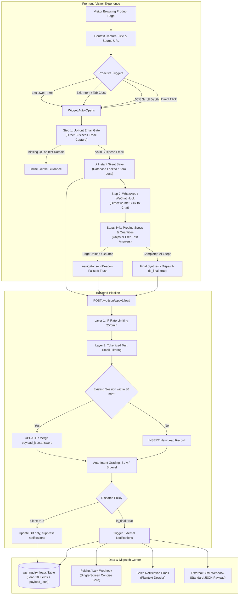

# WP Inquiry Chatbot (ECV Style)

> **High-Converting, Deterministic B2B Conversational Lead Generation Plugin for WordPress**  
> *Zero LLM overhead, 100% conversion focused, context-aware product lead capture, instant Feishu/Webhook dispatch, and native background auto-updates.*

[](https://wordpress.org)
[](https://php.net)
[](LICENSE)
[](https://github.com/GGdm01/wp-inquiry-chatbot/releases)

---

## 🌟 Key Highlights

* 🎯 **Direct Upfront Email Gate**: Bypasses tedious multi-step friction and directly requests business emails upfront. Bounces are locked within milliseconds to guarantee zero lead loss.
* 🛡️ **Anti-Spam & Test Email Interception**: Precision tokenized regex filters (`test@*`, `*.test.*`, temporary domains) prevent spam and test accounts from dirtying your CRM.
* 📦 **Lean 10-Field Database Schema**: Unifies variable form Q&A, specs, and visit metadata into a compact `payload_json` column. Single-row storage is under 300 bytes, scaling to 100,000+ leads without bloating your database.
* ⚡ **Single-Screen Feishu / Lark Card**: Concise interactive cards answering the 3 core sales questions on a single mobile screen: *Who is it? What do they want? How to contact them?* No clutter, no robotic echoes.
* 📥 **Dual Data Export**: 1-click export of leads to **Excel / CSV (with UTF-8 BOM)** and **Structured JSON**, with full status filtering (`All`, `New`, `Contacted`).
* 🔄 **Native WordPress Auto-Updater**: Built-in 1-click update notifications and background automated upgrades (`wp-cron`) directly from your GitHub repository.
* 🔌 **REST API & Webhook Extensibility**: Standard REST API endpoints (`/wp-json/wpi/v1/lead`, `/leads`, `/export`) for external CRM integration and automation pipelines.
* 🪶 **Zero Heavy Dependencies**: Lightweight vanilla JavaScript and CSS (< 35KB combined). Zero jQuery dependencies, zero external framework overhead.

---

## 📐 Architecture & Workflow



---

## 🗄️ Database Schema (Lean 10-Field Model)

Instead of proliferating dozens of rigid columns for every custom question, the plugin consolidates all dynamic specifications into `payload_json`:

```sql
CREATE TABLE wp_inquiry_leads (
    id            bigint(20) AUTO_INCREMENT,  -- Lead ticket ID
    session_id    varchar(64) DEFAULT '',     -- Session identifier for 30-min upsert
    customer_name varchar(100) DEFAULT '',    -- Extracted / inferred customer name
    email         varchar(100) NOT NULL,      -- Verified business email (@ validated)
    phone         varchar(60) DEFAULT '',     -- WhatsApp / phone number
    source_url    text,                       -- Source landing page or product URL
    payload_json  longtext,                   -- Unified JSON (product, answers, visit)
    intent_grade  varchar(10) DEFAULT 'A',    -- S / A / B intent score
    status        varchar(20) DEFAULT 'new',  -- Follow-up status (new / contacted)
    created_at    datetime,                   -- Initial submission timestamp
    updated_at    datetime,                   -- Last update timestamp
    PRIMARY KEY (id),
    KEY email (email),
    KEY session_id (session_id),
    KEY intent_grade (intent_grade),
    KEY status (status),
    KEY created_at (created_at)
);
```

### `payload_json` Structure Example
```json
{
  "product_name": "21.5 Inch Self-Service Kiosks",
  "answers": {
    "Screen Size": "21.5\" - 27\"",
    "Touchscreen": "With Touchscreen (Capacitive)",
    "OS Preference": "Android OS",
    "Estimated Volume": "500 pcs (Standard Batch)"
  },
  "visit": {
    "country": "Germany",
    "ip": "85.214.xxx.xxx",
    "dwell_sec": 42,
    "referrer": "https://google.com/"
  },
  "form_version": "1.4.4"
}
```

---

## 📱 Feishu / Lark Card Notification

The Feishu card layout is strictly optimized for sales mobile review in a single screen:

```text
[Dynamic Color Accent: 🔥 S-Tier (Red) / 🟡 A-Tier (Orange) / ⚪ B-Tier (Blue)]

A-Tier Inquiry #1024 · Germany · yourdomain.com
──────────────────────────────────────────────────────────
Source Website: yourdomain.com
Customer Name: David Miller
Verified Email: david.miller@acme-displays.de (Verified)
WhatsApp / Phone: +49 1522 889977
──────────────────────────────────────────────────────────
Purchasing Specs & Requirements
• Inquired Product: 21.5 Inch Self-Service Kiosks
• Screen Size: 21.5" - 27"
• Touchscreen: With Touchscreen (Capacitive)
• Operating System: Android OS
• Estimated Volume: 500 pcs (Standard Batch)
──────────────────────────────────────────────────────────
Germany · Dwell 42s · 26-10-24 10:30 Submitted
```

---

## 🚀 Installation & Setup

### Method 1: Git Clone (Recommended)
Clone directly into your WordPress plugins directory:
```bash
cd /path/to/wordpress/wp-content/plugins/
git clone https://github.com/GGdm01/wp-inquiry-chatbot.git wp-inquiry-chatbot
```

### Method 2: Manual ZIP Installation
1. Download the [Latest Release ZIP](https://github.com/GGdm01/wp-inquiry-chatbot/archive/refs/heads/main.zip).
2. Go to **WP Admin $\to$ Plugins $\to$ Add New $\to$ Upload Plugin**.
3. Upload `wp-inquiry-chatbot.zip` and click **Activate**.

---

## ⚙️ Configuration

Navigate to **WP Admin $\to$ Inquiry Leads $\to$ Chatbot Settings**:

1. **Enable Chatbot**: Toggle the frontend widget on/off.
2. **Language Configuration**: Choose between `English` (recommended for global B2B sites), `Simplified Chinese` (for domestic portals), or `Auto Detect` (browser locale-based).
3. **Proactive Popup Settings**: Set auto-popup timer (e.g. 15s), exit-intent mouse interception, and scroll depth triggers.
4. **Feishu Webhook URL**: Enter your custom bot webhook URL to receive instant notifications.
5. **WhatsApp / Phone Number**: Set your company's official sales WhatsApp/phone number.
6. **Form & Questions Builder**: Customize question flows, add option chips, and export/import question corpora in JSON.

---

## ⚡ Server-Side 1-Second Setup (CLI)

For developers and server administrators managing WordPress via SSH, Docker, or AppNode/cPanel, you can bypass browser UI uploads and configure the entire plugin in **1~2 seconds** using the native CLI tool:

```bash
# Inside WordPress root or plugin directory:
php wp-content/plugins/wp-inquiry-chatbot/bin/wpi-quick-setup.php \
  --industry=kiosk \
  --feishu="https://open.feishu.cn/open-apis/bot/v2/hook/YOUR_WEBHOOK" \
  --test-feishu
```

### Built-in Industry Archetypes:
* `kiosk`         : Self-service terminals, sheet metal enclosures & commercial touch totems.
* `touch_screen`  : Industrial touch displays, panel PCs & open-frame monitors.
* `stretched_bar` : Ultra-wide stretched bar LCDs, shelf displays & digital signage.
* `lighting`      : Commercial architectural & industrial LED lighting systems.
* `wear_parts`    : Excavator bucket teeth, cutting edges & metallurgy components.
* `battery`       : LiFePO4 energy storage systems & solar battery packs.
* `generic`       : Universal B2B industrial foreign trade flow.

The CLI tool automatically:
1. Detects `wp-load.php` and loads WordPress core.
2. Activates the plugin and verifies the `wp_inquiry_leads` database schema.
3. Injects the tailored 7-step probing questions with strict `@` email validation.
4. Snapshots settings into `wpi_custom_default_questions` (protecting against accidental resets).
5. Tests Feishu interactive card dispatch and purges all page & object caches.
---

## 📡 REST API Reference

All endpoints are registered under the `/wp-json/wpi/v1/` namespace:

| Method | Endpoint | Authentication | Description |
| :--- | :--- | :--- | :--- |
| `POST` | `/wpi/v1/lead` | Public (Rate Limited) | Submit new inquiry or silent session update |
| `GET` | `/wpi/v1/leads` | Admin / Token | Paginated query of inquiries (`?page=1&limit=20&status=new&grade=S`) |
| `GET` | `/wpi/v1/export?format=csv` | Admin / Token | Stream-download UTF-8 BOM CSV export of inquiries |
| `GET` | `/wpi/v1/export?format=json` | Admin / Token | Download full structured JSON export |
| `GET` | `/wpi/v1/ping` | Public | Healthcheck and version probe |

> **Token Auth**: External automation scripts can access protected endpoints by passing the query parameter `?token=YOUR_SECRET` or the header `X-WPI-Token: YOUR_SECRET` (configured via `wpi_webhook_secret`).

---

## 🔄 Automatic Updates

This plugin supports native WordPress 1-click and background automatic updates:

1. Whenever a new version is released on GitHub, a native update banner will appear under **WP Admin $\to$ Plugins**:
   > *There is a new version of WP Inquiry Chatbot available. View version details or update now.*
2. You can also enable native background updates via the **"Enable auto-updates"** toggle in the plugins list.
3. To trigger an immediate check manually, visit **Inquiry Leads $\to$ Settings** and click **"Check for Updates"**.

---

## 🔒 Security & Privacy

* **Zero Leaks**: All personal numbers, internal IP addresses, and private server paths are kept strictly out of the codebase.
* **Rate Limiting**: IP-based transient rate limiting (max 25 requests per 5 minutes) prevents brute-force abuse.
* **Failsafe Delivery**: Employs `navigator.sendBeacon` and `keepalive fetch` to safely transmit pending inquiry data even if a visitor abruptly closes their browser tab.

---

## 📄 License

This project is licensed under the [GPLv2 License](LICENSE).
Author: [GGdm01](https://github.com/GGdm01)
