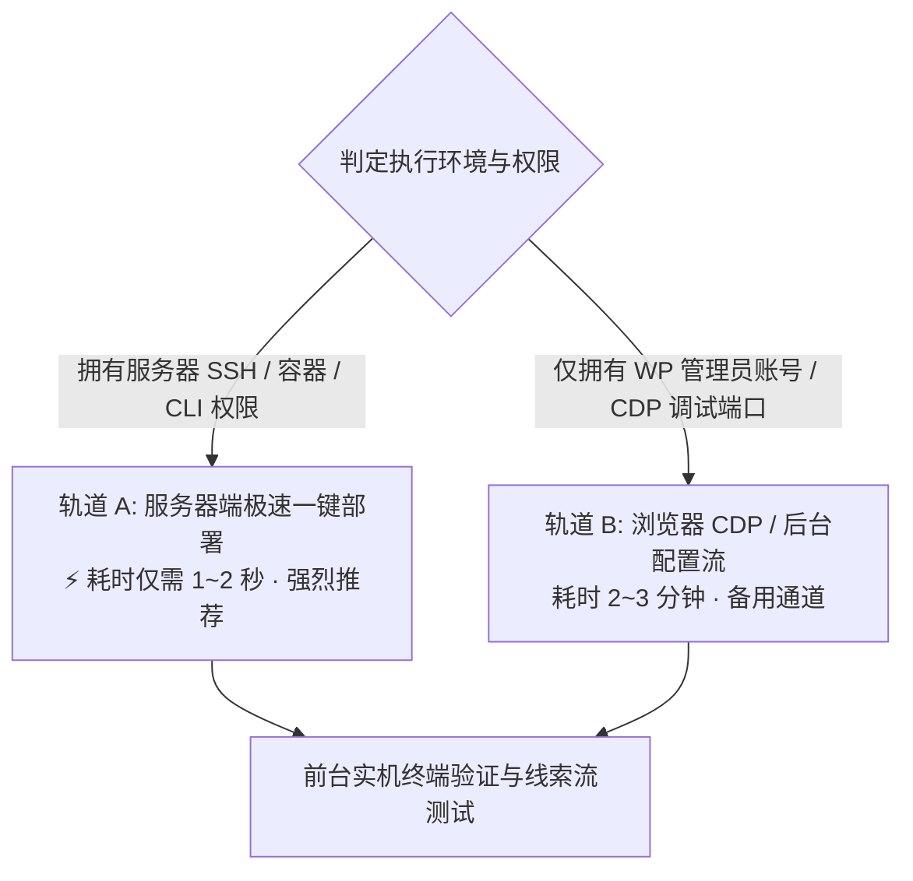

# WordPress B2B 询盘机器人自动化配置与语料定制技能 (wp-inquiry-chatbot-setup)

本技能用于为各类 B2B 外贸制造独立站（如商用自助终端 Kiosk、工业触控屏、条形液晶屏、商用照明、工程机械耐磨件等）快速完成 `wp-inquiry-chatbot` 的版本升级、四维立体产品线与买家定制要素深度分析、业务专属发散式追问表单流（Form & Probing Questions）定制、飞书 Webhook 自动化挂载测试，以及保存为站点专属永久默认预设。

---

## 一、核心设计哲学与铁律

1. **第 1 步绝对强校验商业邮箱门禁（Upfront Direct Email Gate）**：
   - 彻底废除传统的先问称呼、公司名的冗余步骤；第 1 步直接要求买家提供带 `@` 的工作邮箱（配以“发送 CAD 钣金图纸与出厂阶梯批发报价单”的利益诱导）。
   - 用户输入有效邮箱的瞬间，线索立即入库持久化并推送到销售端，彻底杜绝买家在后续多轮问答中途跳出造成的线索流失。
2. **拒绝平庸业余的通用屏提问**：
   - 严禁对所有站千篇一律地只问“屏幕尺寸”、“带不带触控”。
   - 必须先深度分析站点产品线与规格属性，挖掘买家发询价单（RFQ）时的核心工程要素（如 Kiosk 站关注“安装形态、外设模块开孔、打印机/扫码/发卡器、工控主机方案”；工业屏站关注“贴合工艺、安装方式、宽温防水、接口规范”）。
3. **极简轻量点选（Low Friction Mobile-Friendly）**：
   - 后续步骤优先提供 3~4 个典型工程预设选项（支持一键点选或自由输入），极大降低移动端与桌面端的打字阻力。
4. **后台与飞书卡片 2~4 字标签映射**：
   - 所有问题 ID 与提问文案需确保被后端规整为紧凑的 2~4 字中文规格标签（如 `【安装形态】`、`【外设模块】`、`【屏幕尺寸】`、`【主控系统】`、`【预估批量】`）。
5. **定制表单固化为专属默认预设（防手误重置丢失）**：
   - 配置完成后必须自动调用 `save_custom_default` 将配置快照写入 `wp_options`（`wpi_custom_default_questions`），确保后续即使误点预设重置也能一键恢复。
6. **飞书通知的主动提问门禁**：
   - 检查或接收飞书 Webhook 地址，若未提供且站点未配置，必须使用 `ask` 工具主动向用户提问确认。

---

## 二、双轨执行架构（服务器一键部署 vs CDP 浏览器配置）



---

### 🚀 轨道 A：服务器端极速一键部署（推荐 · 1~2 秒完成全流程）

直接通过 SSH 或服务器终端执行插件内置的 `bin/wpi-quick-setup.php`，零依赖、秒级完成底层激活、建表、语料注入、快照固化与缓存清理：

```bash
# 进入站点根目录并执行（支持自动递归向上探测 wp-load.php）：
php wp-content/plugins/wp-inquiry-chatbot/bin/wpi-quick-setup.php \
  --industry=kiosk \
  --feishu="https://open.feishu.cn/open-apis/bot/v2/hook/xxx" \
  --whatsapp="+8618098949445" \
  --test-feishu
```

**参数支持：**
* `--industry`：`kiosk` (自助终端整机), `touch_screen` (工业触控屏), `stretched_bar` (条形液晶屏), `lighting` (商业照明), `wear_parts` (机械耐磨件), `battery` (储能锂电), `generic` (工业通用)。
* `--corpus=/path/to/custom.json`：直接指定自定义 7 步表单文件。
* `--feishu` & `--secret`：飞书机器人 Webhook 与签名密钥。
* `--test-feishu`：配置后立刻向外贸群推送交互卡片验证连通性。
* `--clean-cache`：自动清理 WP Super Cache、LiteSpeed、Seraphinite 等整站缓存。

---

### 🖥️ 轨道 B：浏览器 CDP / WP Admin 后台配置（备用）

在无服务器 SSH / CLI 权限时，走原有的 6 大标准步：

### Step 1：通过 CDP 或凭证登录 WP 后台并核验插件版本

1. **连接目标浏览器 CDP 调试端口**：
   ```bash
   curl -s http://127.0.0.1:<PORT>/json/list
   ```
2. **登录后台并检查插件**：
   - 访问 `/wp-admin/plugins.php`。
   - 检查 `WP Inquiry Chatbot (ECV Style)` 插件版本。
   - 若低于 `1.4.2`，通过 `/wp-admin/plugin-install.php?tab=upload` 上传 GitHub 官方最新版 ZIP（或本地编译包）并选择覆盖升级。
   - 确认版本为 `v1.4.2+`（支持原生自动热更新与 10 字段精简数据架构）。

---

### Step 2：四维立体产品线与买家定制要素深度分析（全面强化）

在控制台或 CDP 环境中抓取站点的产品与规格骨架，杜绝主观臆测：

#### 1. 四维立体数据抓取脚本 (4-Dimensional Asset Harvesting)
```javascript
// 在目标站点控制台运行抓取
const analysis = await (async () => {
  // ① 分类与标签
  const catsRes = await fetch("/wp-json/wp/v2/product_cat?per_page=50");
  const cats = catsRes.ok ? await catsRes.json() : [];

  // ② 产品样本
  const prodsRes = await fetch("/wp-json/wp/v2/product?per_page=30");
  const prods = prodsRes.ok ? await prodsRes.json() : [];

  // ③ 全局商品规格属性 (WooCommerce Attributes)
  const attrsRes = await fetch("/wp-json/wc/v3/products/attributes");
  const attrs = attrsRes.ok ? await attrsRes.json() : [];

  // ④ 主菜单导航结构 (Menu Hierarchy)
  const menuLinks = Array.from(document.querySelectorAll("header nav a, .main-navigation a, #site-navigation a"))
    .map(a => ({ text: a.innerText.trim(), href: a.href }))
    .filter(m => m.text && !m.href.includes("cart") && !m.href.includes("account"));

  return {
    categories: cats.map(c => ({ id: c.id, name: c.name, count: c.count })),
    products: prods.slice(0, 10).map(p => ({ title: p.title?.rendered, slug: p.slug })),
    attributes: attrs.map(a => a.name),
    menuSample: menuLinks.slice(0, 15)
  };
})();
console.log("站点资产分析结果:", JSON.stringify(analysis, null, 2));
```

#### 2. B2B 买家画像与决策维度挖掘
- **买家角色定位**：
  - **系统集成商 / 工程商 (System Integrator)**：最关心外设接口兼容性、模块化开孔结构、安装公差、SDK/驱动支持。
  - **硬件研发工程师 (R&D / Solution Architect)**：最关心主板方案（x86 vs ARM）、散热方式、供电电压、抗干扰与防护等级（IP65）。
  - **贸易商 / 品牌采购总监 (Importer / Wholesaler)**：最关心阶梯批发价、打样交付周期、自定义 Logo/包装丝印、认证资质（CE/FCC/UL/RoHS）。
  - **招投标工程方 (Tender Bidder)**：最关心是否支持按招标文件深度定制、成套出厂检测报告。
- **不可或缺的前置工程参数 (Critical RFQ Prerequisites)**：
  - 提炼销售人员与结构工程师“不拿到就无法出报价和图纸”的核心参数，将其排入第 3~6 题。

#### 3. 六大典型 B2B 工业出海原型库（Archetype Library）
- **原型 1：商用自助终端与集成整机 (Self-Service Kiosk / ATM / Ticketing)**
  - 核心要素：安装形态（立式整机/台式壁挂/嵌入式/户外防水）+ 外设开孔（POS/打印机/发卡器/扫码）+ 屏幕尺寸 + 主控系统（Windows/Android/自备主机）+ 批量周期。
- **原型 2：工业级显示器与工控机 (Industrial Touch Display / Panel PC)**
  - 核心要素：安装方式（嵌入式Open Frame/前锁无缝Flush/后置Rear/VESA）+ 触控方案（电容投射/电阻式/防爆钢化无触控）+ 亮度环境（室内300nit/户外阳光下可视1000nit+）+ 信号接口。
- **原型 3：商业条形液晶屏与数字标牌 (Stretched Bar LCD / Digital Signage / Video Wall)**
  - 核心要素：裁切长宽比例 + 安装朝向（横装/竖装/双面吊挂）+ 信发系统（单机U盘/云端CMS/安卓网络板）+ 供电模式（DC 12V车载/商用AC 220V）。
- **原型 4：商业建筑与特种照明 (Architectural / Commercial / Industrial LED Lighting)**
  - 核心要素：安装结构（铝型材嵌入/悬吊/地埋/水下）+ 光学特性（色温CCT/显指CRI/配光透镜角度）+ 调光方案（DALI/0-10V/DMX512）+ 驱动电源与安规认证。
- **原型 5：工程机械与五金耐磨零部件 (Excavator Bucket Teeth / Wear Parts / Hydraulic Seals)**
  - 核心要素：主机适配品牌（CAT/Komatsu/Hitachi/Volvo）+ 构件型号（J300/J350等）+ 施工工况（常规土方/高磨损硬岩/重载矿山）+ 采购批量（整箱/吨位）。
- **原型 6：光伏与工业储能系统 (Solar / Energy Storage LiFePO4 Battery / Inverters)**
  - 核心要素：电池系统容量/电压（51.2V 100Ah/200Ah等）+ 安装结构（机架式/机柜式/壁挂式）+ 逆变器协议匹配（Growatt/Deye/Victron通信兼容）+ 循环寿命与电芯认证。

---

### Step 3：构建标准的 7 步发散追问表单结构

以分析出的要素为核心，生成符合 `wp-inquiry-chatbot` 规范的标准 7 步 JSON（必须严格包含 `id`, `question`, `type`, `options`, `placeholder`, `require_at_email` 等字段）：

```json
[
  {
    "id": "name_email",
    "question": "Hello, may I have your Name and Business Email to send the CAD drawings and factory quotation?",
    "type": "name_email",
    "required": true,
    "require_at_email": true,
    "prompt_error": "Please provide a valid business email containing \"@\" (e.g. name@company.com) so we can send the quotation.",
    "placeholder": "Your Name & Business Email with @..."
  },
  {
    "id": "whatsapp_contact",
    "question": "Do you use WhatsApp or WeChat for quick engineering review and quotation?",
    "type": "optional_text",
    "options": [
      "📲 Chat on WhatsApp (+8618098949445)",
      "Prefer Email only ✉️"
    ],
    "required": false,
    "placeholder": "Enter your WhatsApp/Phone or select above..."
  },
  {
    "id": "<core_form_factor>",
    "question": "<业务形态与安装方式提问>",
    "type": "choice_or_text",
    "options": ["选项1", "选项2", "选项3", "选项4"],
    "required": false,
    "placeholder": "Select above or describe your enclosure requirements..."
  },
  {
    "id": "<core_peripherals_or_specs>",
    "question": "<核心工程外设/功能配置提问>",
    "type": "choice_or_text",
    "options": ["选项1", "选项2", "选项3", "选项4"],
    "required": false,
    "placeholder": "Select above or list required devices..."
  },
  {
    "id": "<screen_or_dimension>",
    "question": "<尺寸/规格/功率提问>",
    "type": "choice_or_text",
    "options": ["选项1", "选项2", "选项3", "选项4"],
    "required": false,
    "placeholder": "Preferred size or paste a reference model link..."
  },
  {
    "id": "<system_or_driver>",
    "question": "<系统/驱动/芯片/协议配置提问>",
    "type": "choice_or_text",
    "options": ["选项1", "选项2", "选项3", "选项4"],
    "required": false,
    "placeholder": "Specify OS, CPU, RAM or driver requirements..."
  },
  {
    "id": "project_volume",
    "question": "What is your estimated order quantity and project schedule?",
    "type": "choice_or_text",
    "options": [
      "Prototype / 1-2 units sample test",
      "Trial batch (10 - 50 units)",
      "Roll-out / Mass production (> 100 units)",
      "Government / Enterprise Tender stage"
    ],
    "required": false,
    "placeholder": "e.g. 50 units needed in 2 months..."
  }
]
```

---

### Step 4：飞书 Webhook 交互确认与测试连通

1. **检查与用户提问门禁**：
   - 检查 skill 调用参数或当前后台（`/wp-admin/admin.php?page=wpi-settings`）中的 `wpi_webhook_url` 是否已存在。
   - 若未提供且后台为空，**必须使用 `ask` 工具主动向用户确认**：
     > “请问是否需要为此站点配置飞书实时询盘推送机器人？请提供飞书 Webhook 机器人地址（选填密钥）。如暂不配置飞书通知，请输入 'skip' 跳过。”
2. **自动化写入配置**：
   - 访问 `/wp-admin/admin.php?page=wpi-settings`，填入 `wpi_webhook_url` 与 `wpi_webhook_secret` 并提交保存。
3. **连通性实测验证**：
   - 在设置页面点击「发送测试工单卡片至飞书群」（`#wpi-test-webhook-btn`）。
   - 确认返回 `{"success": true}` 并在飞书群收到带有该站域名标签的测试互动卡片。

---

### Step 5：注入表单并固化为站点专属默认预设（关键防丢机制）

为防止后续日常运营或管理员误点“恢复预设”将定制语料覆盖，必须执行**双层固化**：

1. **表单注入并保存（生效到当前运行时）**：
   - 访问 `/wp-admin/admin.php?page=wpi-form-builder`。
   - 在 `wpi_import_corpus_json` 文本框注入 `{"form_questions": [...]}`。
   - 提交表单保存，验证 7 步卡片完整呈现。
2. **固化为站点专属默认预设（Snapshot Persistent）**：
   - 访问 `/wp-admin/admin.php?page=wpi-settings`。
   - 触发内置安全链接：`admin.php?page=wpi-settings&action=save_custom_default&_wpnonce=...`。
   - 确认后台提示：“已成功将当前调整好的追问表单流程与 FAQ 规则保存为「站点专属默认预设」！”
   - 此时 `wpi_custom_default_questions` 将永久锁定该 7 步表单。若未来发生误改，点击「🔄 恢复为自定义默认预设」即可 1 秒还原。

---

### Step 6：清除整站缓存与前台端到端实机验证

1. **清除全站缓存**：
   - WP Super Cache：访问 `/wp-admin/options-general.php?page=wpsupercache` 点击「删除缓存」。
   - 其他缓存插件（Seraphinite / WP Rocket / LiteSpeed）：执行对应 Purge All 操作。
2. **前台商品单品页实测**：
   - 浏览器打开任意代表性产品单品页（如 `/product/xxx/`）。
   - 检查浮窗标题与上下文横幅：是否精准捕获 `CURRENTLY VIEWING: <Product Title>`。
   - 模拟填表交互：
     - 输入有效邮箱 `test@company.com`，点击发送。
     - 确认前端顺利流转至 Step 2 WhatsApp 即时选项。
     - 确认 Step 3~7 选项按钮均可直接点选，且选项文本与站点业务高度贴合。
3. **后台工单与飞书核验**：
   - 检查 `/wp-admin/admin.php?page=wpi-leads` 是否成功生成新工单。
   - 检查工单的 `payload_json` 是否规范格式化包含所选的各步规格参数。
